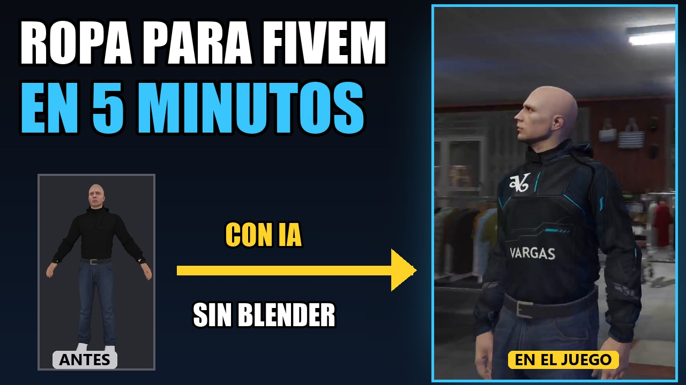

# Vargas Clothing

Free Windows tool to create addon clothing for FiveM without Blender or OpenIV.

**Video tutorial (Spanish):** https://youtu.be/txnngxIjNOE
**Support / Discord:** https://discord.gg/KxPYKYYYVT

## Download

[**VargasClothing.exe**](https://github.com/vargasISDK/vargas-clothing/raw/main/VargasClothing.exe) (Windows, about 72 MB, no installer)

## What it does

- Opens a clothing pack you already have and lists every garment, with filters by gender and type.
- Shows each texture in 2D and the garment on a 3D mannequin (right click rotates, wheel zooms).
- Draws the UV map over the texture, so you can screenshot it and ask an image AI (ChatGPT, for example) for a new design that fits the garment.
- Imports images and logos as layers: size, rotation and opacity, with a live 3D preview.
- Adds text layers with font and colour.
- Places real 3D objects (STL or OBJ) on the garment, either rigid like a badge or following the cloth like a patch.
- Applies the design to every colour variant and collects as many garments as you want.
- Exports a complete FiveM resource plus a LEEME (readme) file that explains how to install it and where the garment appears in the clothing menu.

## How to use the exported resource

1. Copy the exported folder into your server `resources` folder.
2. Add `ensure your_resource_name` to `server.cfg`.
3. Restart the server. New garments appear at the end of their category in your clothing shop.

## Notes

- The app works on clothing packs you already own. It does not ship any clothing assets.
- The interface is in Spanish for now.
- Do not use real-world brands or logos you have no rights to; the Cfx.re platform rules forbid them.

---

## Español

Herramienta gratuita para Windows con la que creas ropa addon para FiveM sin Blender ni OpenIV: eliges una prenda base de un pack que ya tengas, le aplicas un diseño (el mapa UV te sirve para pedírselo a una IA), añades texto y logos en 3D, y exportas el resource listo para hacer `ensure`.

- Tutorial en vídeo: https://youtu.be/txnngxIjNOE
- Soporte y novedades: https://discord.gg/KxPYKYYYVT
